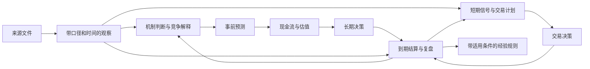

# 建立能学习的投资研究反馈系统

> **状态更正（2026-10-10）：未验证初稿，不能据此直接迁移。** 本文写作时未读取现有 Cowork skills，对现有反馈机制的认识不完整；关于机制缺失的概括已撤回。现状与修订方向以[机制核对报告](现有机制核对_2026-10-10.md)为准，本文其余内容仅保留为待评估的方法建议。

研究日期：2026-10-09｜设计对象：现有 61 家公司资料库｜同时覆盖长期投资与短期交易

## 一、研究结论

建议采用用户提出的三个主目录：**事实资料、研究判断、判断演化**。这三个目录分别回答：我们掌握了什么证据；目前怎样理解公司与价格；过去的判断如何被新证据检验和修正。

反馈系统的基本单元应从“报告”转向**可追溯、可检验的判断**。报告仍是阅读入口，但核心判断必须有身份、来源、适用期限、反证条件和后续处理记录。长文不断增加不等于知识不断改善；只有旧判断可以被找回、被结算、被改进，系统才能留下有效经验。

长期投资与短期交易使用共同的事实底座，却需要独立的判断记录、评价基准和风险预算。长期判断关心商业机制、现金流、资本配置与价值；短期判断关心价格路径、催化剂、交易信号、成交与成本。两者在组合决策层汇合，不能让任何一方事后替另一方改写失败标准。

**这套系统可以提高过程的可检验性，并为提高判断质量创造条件；是否提高预测能力和净投资回报，仍需前瞻记录、合适基准和足够样本验证。**

## 二、现有系统已经具备什么，缺少什么

本次只读统计发现：`companies/` 下有61个公司目录；61个有研究档案、技术分析和催化剂目录，60个有历史目录，60个有名称匹配`*Wiki`的目录，20个有`_events`。这是目录覆盖统计，不代表内容完整、正确或已更新。

现有 `_system/dossier_schema.md` 已定义企业文化、财务分析、商业模式、战略、股性、预测、估值的依赖关系，并有交接块、过期标记、待审发布和历史备份。应该保留这些有用的结构。其局限是：能够说明“报告如何生产”，尚不能充分说明“判断后来是否准确，以及为什么”。[本地规范](<../_system/dossier_schema.md>)

| 现有能力 | 尚需补上的反馈能力 |
|---|---|
| 原始公告、财报和电话会文件 | 把文件中的具体观察提取成可定位、带口径与时间的信息记录 |
| 01–07研究报告 | 给少量关键判断分配固定ID与检验标准 |
| `_history`更新前备份 | 明确版本生效时间、输入版本及当时可知信息 |
| 更新摘要、催化剂跟踪 | 对旧预测按原规则结算，区分新消息与旧消息的重复传播 |
| 技术分析报告 | 锁定信号有效期、入场/退出规则、真实执行和交易成本 |
| 估值与仓位脚本 | 区分研究概率、计分标签、配置权重，并追踪其各自表现 |
| 研究网站和日报 | 展示未决分歧、到期预测、质量问题，而不只是最新评级 |

TCOM已暴露几类具体问题：历史目录日期与正文版本不同；早期EFG稿与后续DCF追述不对应；02已经更新到Q2而06/07仍称其为Q1；“费用峰值已过”被后续数据反证；目标价接近不变但现金流与汇率贡献方向相反。它们说明需要“判断与证据的关系”，不能只靠文件命名和最终目标价。[TCOM证据地图](<../companies/TCOM 携程/TCOM Wiki/wiki/research-source-map.md>)、[观点演变](<../companies/TCOM 携程/TCOM Wiki/wiki/research-thesis-evolution.md>)

另外，现行凯利脚本将主导情景转换为配置用权重：基准主导为牛20%/基准60%/熊20%；牛或熊主导使用60/30/10方向倾斜。它们是配置规则，不能自动等同于06中的主观概率，也不是已经校准的真实发生概率。这是新系统需要显式记录的模型边界，本次未修改该规则。[kelly_engine.py](<../_system/scripts/kelly_engine.py:151>)

## 三、研究依据及其适用边界

### 1. 反馈应落到具体预测

Mellers等人的预测竞赛研究发现，概率训练、团队协作与表现跟踪可以改善地缘政治预测的校准和区分能力。这支持把模糊判断拆成明确问题、使用基准率、持续记录与检验，但不能直接推导为股票超额收益。本文采用的是这种可检验设计，而非复制竞赛形式。[Mellers等，2014](https://escholarship.org/uc/item/4rg4n9vr)

### 2. 事前记录用于防止答案出来后改变问题

预注册研究强调，在结果未知时声明假设与分析规则，有助于减少结果驱动的调整并提高透明度。投资中仍须随新信息更新，但应新增版本而非擦掉旧版本。其对应实践是：预测阈值、期限、判定来源先锁定；新规则对未来生效。[预注册与偏差，Nature Human Behaviour](https://www.nature.com/articles/s41562-022-01497-2)

### 3. 概率需要适当的评分方法

严格适当评分规则的目的，是鼓励预测者报告真实概率，而不是为了看起来正确而调整表达。二元事件可用Brier分数；连续量可另行使用绝对误差、区间评分等。本系统不把“高/中/低信心”直接当成可校准概率。[Gneiting与Raftery，2007](https://sites.stat.washington.edu/people/raftery/Research/PDF/Gneiting2007jasa.pdf)

### 4. 价值、价格、结果必须分别观察

估值依赖未来现金流及不确定假设。市场价格会变化，模型估值也会变化，但未来某日价格并不是“真实内在价值”的直接标签。因此应分别检验经营预测、估值方法的敏感性与一致性，以及实际投资回报。[Damodaran：估值与不确定性](https://pages.stern.nyu.edu/~adamodar/New_Home_Page/background/valintro.htm)

CFA Institute对结果偏差的说明强调，不应只按回报结果评判形成该结果的过程。本方案据此并列记录事前决策质量与事后结果，避免把一次赚钱归为能力、一次亏钱归为错误。[CFA Institute：行为金融中的结果偏差](https://www.cfainstitute.org/sites/default/files/-/media/documents/book/rf-publication/2018/risk_compilation_2018.pdf)

### 5. 短期交易还需要控制选择偏差与实施成本

Bailey与López de Prado指出，多次试验后只展示最佳策略，会夸大表现；其Deflated Sharpe Ratio用于处理部分多重检验和非正态问题。个人系统首先要保存全部试验及规则版本，而不是急于用复杂统计给少量交易认证。[原始论文](https://www.davidhbailey.com/dhbpapers/deflated-sharpe.pdf)

AQR基于实际机构交易研究成本与冲击，说明实施条件会影响结果。本文只借用“信号收益与实施收益分开”的原则；机构的成本估计不能直接作为个人账户佣金、滑点或容量假设。[Trading Costs](https://www.aqr.com/insights/research/working-paper/trading-costs)

以上研究提供方法依据。下文的目录、字段、阈值和工作节奏是针对当前资料库提出的设计建议，并非这些文献已经验证的完整投资系统。

## 四、三个目录的边界

建议目录如下。根目录的首页是导航；三个主目录保持用户要求的语义。

```text
TCOM 携程/
├─ 公司首页.md
├─ 01_事实资料/
│  ├─ 来源/                  原始公告、财报、电话会、第三方报道
│  ├─ 指标/                  结构化观察、指标定义与可比性规则
│  ├─ 事件/                  已发生事件、已公告日程、管理层表述
│  ├─ 公司知识/              业务/产品/组织/历史的可核实资料页
│  └─ 来源清单.json
├─ 02_研究判断/
│  ├─ 当前发布.json          指向唯一已发布的判断版本
│  ├─ 长期投资/              当前01–07模块、模型与反推估值
│  ├─ 短期交易/              当前有效交易设想与规则版本
│  ├─ 待验证判断.md          按价值影响排序的未知项
│  └─ 草稿/                  尚未发布的分析
└─ 03_判断演化/
   ├─ 版本/                  已发布快照与依赖清单
   ├─ 预测记录/              每一次事前预测及后续结算
   ├─ 决策记录/              买卖/持有/不做的当时理由与条件
   ├─ 更新记录/              旧判断→新证据→新判断
   ├─ 复盘/                  偏差归因与方法修正
   └─ 经验规则/              候选经验、适用边界、反例、验证状态
```

### 事实资料：保留证据，不承诺来源永远正确

事实层至少区分四类内容：

| 类型 | 例子 | 如何表达 |
|---|---|---|
| 披露观察 | 公司某期披露收入为X | 记录报表、科目、期间、单位、页码、是否重述 |
| 可复算指标 | 用同口径收入与销售费用算费用率 | 保留公式与输入记录ID，标为派生值 |
| 来源主张 | 管理层称费用增长来自国际营销 | 确认“说过这句话”；原因是否成立仍要研究 |
| 待核线索 | 新闻称竞争对手抢占份额 | 保留媒体与原始出处、核验状态，不能进入已核实指标池 |

同一电话会被十家媒体转述，仍可能只是一个证据源。需要`origin_source_id`或证据簇，避免把转述数量当独立支持。

“没有指引”也应注明检索范围：查了哪次公告与完整电话会、截至何时未发现；不能泛化成公司所有渠道均未给指引。

公司知识页可以是Wiki。原则是写可核实关系，例如品牌归属、收入确认方法、历次公开行动；“护城河强”“管理层可信”“具备定价权”进入判断层。

**混合文件不按文件名整体判定为事实。** 原有研究报告先保留在判断层，再将确有来源支撑的数字逐步提取到事实层。第三方研究报告作为来源可以进入原始资料区，但其预测不能因此升级为公司事实。

### 研究判断：只呈现当前有效认识

保留01–07主题，降低迁移成本，同时补充四种关键对象：

- **机制判断**：为什么会这样，例如竞争方式改变怎样影响佣金与费用。
- **可结算预测**：在何时、按什么口径、会观察到什么。
- **估值状态**：输入、方法、情景、概率或非概率标签、敏感性。
- **行动计划**：在何种价格、风险约束和触发条件下做什么。

这些对象通过ID连接，不要求每一个句子单独建文件。初期每家公司维护3–5个关键机制判断、每次财报3–8个高价值预测足够；数量是工作负担建议，不是统计有效性门槛。

旧报告的长篇历史叠加逐步迁往演化层，当前正文只保留当前判断和必要解释；这可减少AI同时读到旧结论、新结论却不知道谁有效的问题。

### 判断演化：保存当时的认识与后来如何处理

历史备份说明“文件不同”；演化记录还应说明“为什么变、变化是否合理”。至少保存：旧版本、新证据、新版本、被修改参数、价值影响、下一次检验条件，以及判断者/工具与时间。

保留两种互补视图：**发布快照**便于复现整套研究；**逐条判断事件**便于追踪同一观点。可先用文件与索引实现，不必启动时就建立图数据库。

## 五、连接三层的是证据链与时间，而不是更多文件夹

关系可以简化为：



### 1. 每个对象有稳定ID

例如`TCOM-H-001`表示“某项费用改善是否可持续”的机制判断；不同日期更新该判断形成新版本。`TCOM-P-001`是一个具体预测问题；概率更新为其新预测版本，不能换ID逃避原预测的结算。问题口径或期限改变，则新建问题ID并说明与旧问题的关系。

新资料到来时，通过依赖关系知道需要复核哪些预测与估值，避免每次把所有报告重写一遍。数据血缘思想可参考W3C PROV对实体、活动、责任主体的区分；这里采用轻量字段，不要求完整实现其本体。[W3C PROV Primer](https://www.w3.org/TR/prov-primer/)

### 2. 至少区分四个时间

| 字段 | 含义 | 用途 |
|---|---|---|
| `effective_period` / `event_at` | 经营期间或事件发生时间 | Q2经营数据不被当作7月底整改后表现 |
| `published_at` | 来源何时公开 | 判断当时市场能否知道 |
| `recorded_at` / `available_to_system_at` | 何时入库并可被系统使用 | 区分市场已知与自己实际取得 |
| `issued_at` + `data_cutoff_at` | 判断何时形成、允许使用信息截至何时 | 防止历史回放混入未来数据 |

具体到买卖，另记`decision_at`、`order_at`、`fill_at`及交易所时区。公开信息可用性的回测与系统实际可用性的回放应分别标记。历史资料缺少采集时间时留空或标未知，不以文件修改时间伪造。

这种设计借鉴“双时间历史”将实际发生与记录获知分开的思想，并按投资研究补充公布和决策时间。[Martin Fowler：Bitemporal History](https://martinfowler.com/articles/bitemporal-history.html)

### 3. 纠错不能抹掉旧信息集

公司重述财报时，同时保留首次披露与重述版。当前分析可用重述版，但评价过去决策应先还原当时可得版本。若用重述值重新评分，另列“重述后结算”，不能悄悄改原分数。

**事实有修订历史，判断有修订历史，规则也有修订历史。** 三者都需要版本；否则从旧档案中重建出来的准确率很容易包含后见信息。

## 六、完整反馈循环

### 第一步：从最重要的未知开始

每家公司首页维护三项：价值最依赖什么；哪些因素尚不清楚；什么新信息最可能改变行动。用定性高/中/低估计研究优先级：**对决策的潜在影响 × 不确定性 × 可获得证据的可能性，相对于研究成本**。这是排序启发式，不是可精确计算的概率公式。

没有影响模型、风险或交易条件的新闻，可以归档但不触发重估。允许“已读、无实质变化”的记录，防止为展示工作量而不断改结论。

### 第二步：锁定当前判断与替代解释

每个关键判断写出：支持证据、反证、竞争解释、适用范围、失效条件。至少提出一种与当前结论不同且可观察的机制。例如费用上升可以来自国际扩张、国内防御、收入分母减速或一次性活动；这些解释对长期现金流的含义不同。

先列同类公司或历史阶段作为基准率参考，再说明本公司为什么偏离。参考类的成员、选择日期和幸存者范围应记录；不能在结果出现后只挑“相似赢家”。

### 第三步：把关键机制转成可判定预测

“护城河强”难以结算；“下一次规定财报口径下，某项费用率低于预先确定阈值”可以。具体问题至少带：指标定义、期间、阈值/区间、概率或点预测、来源优先级、公布延迟规则、缺失/重述处理、结算截止时间。

不是所有长期观点都能变成一个二元问题。保留机制性判断，用多个连续指标逐步检验；不能把一项代理指标通过与否当作整套长期论点得到证明。

### 第四步：形成带版本的决策

长期决策记录价值分布、市场隐含假设、组合约束和“不投资”的替代方案；短期交易记录入场触发、取消条件、止损/止盈/时间退出、预计成交规则和成本。

长期目标价是条件估值；要用来估计持有期回报，还需要价格向价值收敛的时间、现金分配、稀释与风险假设。不能机械把DCF上行空间当成一年的期望收益，更不能当成十日交易的胜率。

### 第五步：新证据入库，先结算旧问题

顺序很关键：

1. 提取新证据、核对口径与日期。
2. 对到期旧预测按原标准结算；未到期的保留，不因不利消息改期限。
3. 记录支持、削弱或无法判断的原因。
4. 再形成新的预测与研究版本。
5. 重新计算受影响估值与行动条件，并发布完整依赖版本。

“原标准不适用”可以是合法结论，但要用预先的缺失规则，统计这类问题的数量和占比，避免只留下容易评分的赢家。

### 第六步：将变化分成四类

| 变化类型 | 例子 | 应记录在哪里 |
|---|---|---|
| 新事实 | 新季度经营读数 | 来源与观察、相关判断更新 |
| 认知修正 | 同样材料下发现原因果解释不成立 | 判断版本与认知复盘 |
| 数据/计算纠错 | 单位错误、净现金重复计入 | 纠错记录与依赖失效 |
| 决策规则改变 | 仓位上限、交易退出条件变化 | 策略版本；仅向未来生效 |

不能把单位纠错记成“成功预测”，也不能把汇率贡献记成“公司经营改善”。

### 第七步：让复盘真正改变下一次研究

复盘至少产出一条可执行调整：增加某种核验；降低某类证据权重；扩大预测区间；修改模型结构；暂停某个交易规则；或者记录“当前证据不足，不改规则”。经验记录带适用条件、反例与下次验证方式，状态依次为候选、试用、验证中、保留或停用。

一家公司、一个季度的反例通常足以质疑原结论，但不足以证明一个普遍规律。跨公司汇总时按行业、预测类型和期限分组，并对相关事件聚类，避免把同一次行业冲击当成数十条独立经验。

## 七、长期投资与短期交易如何共存

### 两套时钟和两个逻辑账本

| 项目 | 长期投资 | 短期交易 |
|---|---|---|
| 主要对象 | 业务机制、现金流、价值与资本配置 | 信号、价格路径、催化剂与执行 |
| 常用期限 | 季度验证，1–3年或更长论点 | 日内/数日/数周，按策略明确 |
| 更新触发 | 财报、战略/竞争/监管等重大变化 | 价格/量能/波动/事件条件 |
| 失效标准 | 关键机制被反证、价值或风险结构改变 | 触发失败、止损、超时、流动性变化 |
| 核心评价 | 经营预测、价值假设、长期基准回报 | 净期望、回撤、执行偏差、成本 |
| 防止混淆 | 股价短期下跌不自动证伪公司价值 | 亏损后不能自动改名长期投资 |

每笔决策有`strategy_id`、`horizon`和`capital_bucket`。长期与短期可在同一真实账户操作，但逻辑账本必须能分开归因。经纪商仓位是最终持仓事实；两个虚拟账本之和必须与实际账户逐日对账。

同股长短仓位“内部转移”需在当时可执行或明确约定的市场参考价登记：原策略终结并保留盈亏，新策略登记新决策；注明是记账转移而非真实成交，不能创造虚构利润或掩盖原交易亏损。

### 冲突处理应成为预先规则

| 长期判断 | 短期判断 | 系统输出 |
|---|---|---|
| 看好 | 趋势弱 | 保留长期论点；长期买入节奏与短期禁止入场分别显示 |
| 看空或证据不足 | 有反弹交易条件 | 可显示独立交易计划；不据此升级长期估值 |
| 看好 | 做多条件成立 | 计算合并后的同股暴露，不能把两种理由当成两份分散投资 |
| 核心事实有重大疑点 | 任意 | 对受影响的新决策标记依赖缺口；先核验或明确例外理由 |

组合层统一处理：同股总暴露、行业/风格相关性、杠杆、流动性、币种与集中度。公司页不能独自决定账户风险。具体资本桶比例与风险上限取决于实际账户约束，本次不设固定配比。

### 短期信号的结算细节

必须区分“预测未来十个交易日收益”“先触及止盈还是止损”“按规则实际可成交的交易”。三者标签不同。日线同一根K线同时触及止盈与止损时，顺序未知；按事先设定的保守规则或更细数据处理，不能自动选择有利路径。跳空止损按可执行成交估计，不保证止损价成交。

收盘后才形成的信号不能默认在当天收盘价成交；停牌、财报盘后、复权、分红、时区、借券/融资成本等都要进入规则或数据说明。未执行信号、被取消计划和未买入的观察对象也要留档，否则评价会受选择偏差影响。

研究与参数选择用训练/验证时段，最终评估留给未参与调参的后续数据；重叠持有期避免混入训练与测试。低样本先做前瞻模拟和过程核验，不宣称发现稳定优势。

## 八、怎样判断系统是否越来越准确

建议保留四张独立成绩单，不合成一个总分。

### 1. 信息质量

关键结论来源覆盖率、缺口数量、口径冲突率、过期依赖数、从原文到入库的延迟、版本可复现率。普通文件数和字数不作为学习成绩。重要事实被重述时，检查受影响链条能否被找到。

### 2. 预测质量

**二元事件**使用 `BS = mean((p − y)^2)`，本方案取0至1尺度，越低越好。例如事前p=0.7而事件发生，分数0.09；未发生，0.49。这里是评分示例，不是TCOM旧预测。用相同问题与相同预测提前期，比较公司自己的历史基准率、简单持续性预测等事前基线；不能不加区分地把0.25当所有任务的基准。

**连续量**：收入/现金流记录原单位MAE与有符号偏差；利润率记录百分点误差。接近零或可为负的利润不宜用MAPE。中位数预测对应绝对误差，均值预测对应平方误差；模型标签必须说明预测的是什么。

**区间预测**：预先注明是80%预测区间还是情景上下界。80%预测区间应一起看覆盖率和宽度；无概率含义的熊牛区间不能伪装成80%区间。后续可加入区间评分，避免靠无限放宽区间提高“命中率”。这些评分方法借用适当评分规则框架，具体报表是本方案设计。[Gneiting与Raftery](https://sites.stat.washington.edu/people/raftery/Research/PDF/Gneiting2007jasa.pdf)

**样本规则**：每个问题在固定提前期取一份冻结预测，或使用预定时间权重；不能把同一事件的十次更新计成十个独立命中。显示已结算数、未结算数、缺失数及事件簇数量。概率校准分桶只有样本充足时才展示稳定结论，并报告不确定区间；没有统一的“做满20次就证明有能力”的门槛。

### 3. 研究与估值质量

先问经营驱动能否预测，再问估值模型是否自洽：

- 是否准确识别收入、利润率、再投资、稀释和资本配置的主要驱动？
- 新证据是否改变原机制，还是只改变参数？
- 每次价值变化能否桥接到现金流、折现、时间、净现金、股数和汇率？
- 在不同合理方法下结论是否稳健？终值、概率或倍数是否主导全部结论？

对于未来回报，可以预先固定期限检验相对基准和收益分布，但标签必须写“价格/回报预测”，而非“内在价值真值”。用后续已实现现金流回看估值中的部分假设有帮助，却不能消除未实现终值与折现不确定性。

### 4. 决策与交易质量

事前质量看证据、备选方案、风险约束与规则遵守；事后结果看净回报、回撤、风险暴露与机会成本。

短期单笔`R = 实际净损益 / 事前计划风险金额`，允许实际损失超过1R。策略期望可写成“胜率×平均盈利R−败率×平均亏损R”，成本已计入净损益时不能再扣一次。配合平均持有期、执行偏差、最大不利/有利波动和取消率，不只看胜率。

长期与短期分别使用预先选定的适当基准、统一币种和含分红口径；账户总收益处理入金出金影响。增加简单的等权、持有或不交易基线，防止复杂系统只是增加换手。

| 事前过程 | 结果好 | 结果差 |
|---|---|---|
| 证据与风险处理合理 | 保留方法，检查是否只是环境有利 | 检查机制、概率尾部与执行，不凭一笔结果全盘推翻 |
| 过程有缺陷 | 同样记录错误，防止运气强化坏习惯 | 修正过程，同时区分是否存在额外执行问题 |

这个表是复盘框架，不是把不利结果无限解释为“运气”。连续同类偏差必须回到基准和统计检验，必要时停用模型。

## 九、工具、AI与人工如何分工

### 权威记录只写一处，其他地方生成视图

建议逐步形成：原文与结构化观察为证据源；判断版本与发布清单为研究源；成交与账户快照为执行源；网站、日报、目录索引和汇总表是生成视图。

“单一事实源”应只表示数据管理权威，不能表示估值是真的。现有`valuation_registry.json`更准确地说是“已发布估值登记表”。迁移期间继续使用它，但补上所依据的发布ID、方法与时间；长期从唯一发布记录生成，避免多处人工写入同一目标价。

### AI适合做的工作

资料提取、单位/期间比对、重复来源识别、关键数值勾稽、过期依赖提醒、按原标准结算、生成估值变化桥、提出竞争解释、查找相似历史错误。

AI输出进入事实层前应有原文定位；不存在定位的数字留在待核状态。旧AI报告可作为“过去的判断”，不能循环引用为新事实。记录生成模型/工具与提取规则版本，是为了定位错误来源，不必为每段文字建立庞大日志。

历史回放还存在模型训练知识可能知道未来结果的问题：即便只向AI提供旧文件，也不能保证其完全忘掉后续事件。历史AI重建属于回顾分析；验证新增预测能力优先使用今后真实登记的前瞻样本。

人工重点审阅高影响事实争议、模型结构变化、预测问题定义与交易风险例外。常规资料整理、链接检查、到期提醒可以自动化；规则变动要带版本，不能悄悄让自动系统越来越偏离最初方法。

### 存储从轻开始

初期：Markdown正文 + YAML元信息 + 每类记录的JSON/CSV索引 + 原始附件。预测和交易事件采用追加记录，当前页面由索引整理。后期当查询/对账复杂时，再引入SQLite与全文检索；不必先做知识图谱平台。

本地只追加约定不是防篡改保证。发布快照应结合文件哈希、版本控制与独立备份；有严格审计需要时再增加签名/外部时间戳。不可假设互联网原文永远可重下载：关键证据的原始版本本身具有历史价值。

## 十、更新节奏与实施优先级

| 触发 | 处理 | 产出 |
|---|---|---|
| 新公告/新资料 | 提取事实与评估是否影响判断 | 证据记录；无影响也可记一行 |
| 交易日结束 | 对账信号、成交、成本与失效条件 | 短期账本与例外，不重写长期报告 |
| 每周 | 检查到期预测、过期依赖、重大未决问题 | 简短研究任务表 |
| 财报/重大事件 | 结算旧预测→更新模型→发布新版本 | 一次完整长期反馈循环 |
| 每月或足够新样本后 | 策略表现与跨公司错误分类 | 候选方法修正 |
| 季度 | 复核基准、校准、规则与资源投入 | 保留/试用/停用清单 |

以上是建议频率，未创建定时任务。短期交易的具体频率取决于策略，不预设必须每天交易。

实施分四个阶段：

1. **先建立语义与记录**：在TCOM旁建立试点材料，关键判断编号、发布基线、预测与交易计划模板；不先全库搬迁。
2. **完成一个真实循环**：至少有新证据让旧问题到期结算；交易侧完成若干完整计划和对账。阶段目标是闭环完整，不是证明超额收益。
3. **改造路径与发布接口**：让现有脚本读取路径配置、发布ID和输入版本；试点迁移、对比旧新输出、一致后切换。
4. **跨公司扩展与校准**：先扩大到不同业务特征的少数公司，再扩展到全库；按样本质量决定是否引入更复杂评分、数据库与统计检验。

详细迁移映射、TCOM示例与验收标准见[TCOM实例与迁移路线](<TCOM实例与迁移路线.md>)；可直接复制的字段见[记录契约与模板](<记录契约与模板.md>)。

最终首页应让你在几分钟内回答五个问题：**当前最重要的认识是什么；它依赖什么；什么会证明它错；何时能知道；如果错了，模型与行动怎样改变。** 这五个问题贯通，三个目录才真正构成反馈系统。
